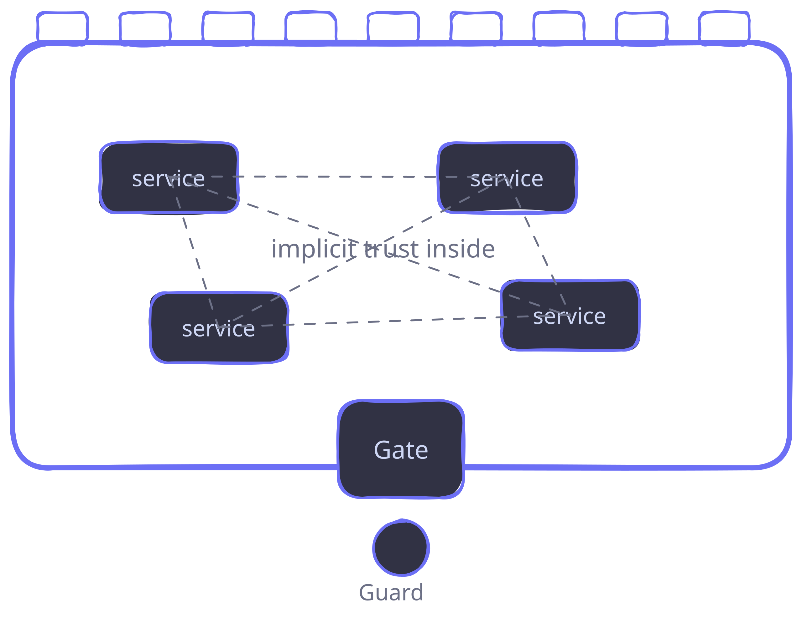
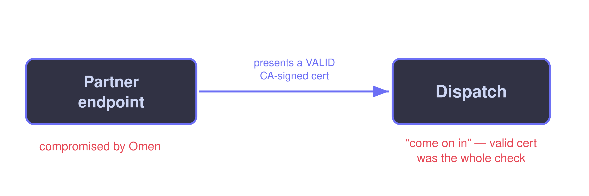
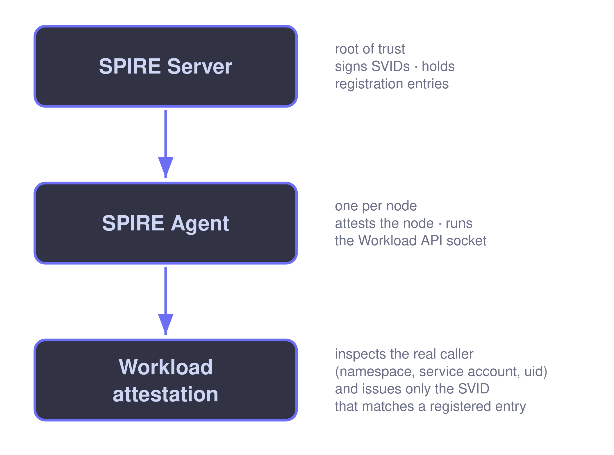

Can I Trust You?
================

## Service-to-Service Identity with SPIFFE

<!-- newlines: 2 -->

_When service A calls service B — how does B know it's really A?_

<!-- newlines: 2 -->


<!-- end_slide -->

The Castle
==========

<!-- newlines: 1 -->



<!-- newlines: 1 -->

## Great walls. Great gate. And then… implicit trust everywhere inside.


<!-- end_slide -->

The Thesis
==========

<!-- newlines: 2 -->

# "Inside the network" is not an identity.

<!-- newlines: 1 -->

Any service can walk up to any other and say
_"hey, it's me"_ — and be believed.


<!-- end_slide -->

Round 1 · The System
====================

<!-- newlines: 1 -->


<!-- newlines: 1 -->

## Trust rule: _"it came from inside the cluster."_


<!-- end_slide -->

Round 1 · The "auth"
====================

```python
# dispatch_service.py — "authentication" 
@app.post("/ship")
def ship(order: ShipRequest):
    # It came from inside the cluster, so it's fine. Right?
    warehouse.dispatch(order.package_id, order.address)
    return {"status": "shipped"}
```


<!-- end_slide -->

Omen Enters
===========

<!-- newlines: 1 -->


<!-- newlines: 1 -->

## A 0-day on the gateway → a foothold inside the walls.

<!-- newlines: 2 -->

_Photo by Mohammad Rahmani on Unsplash_


<!-- end_slide -->

Round 1 · Lateral Movement
==========================

```python
# Omen, now running inside the cluster:
httpx.post(
    "http://dispatch.internal/ship",
    json={"package_id": "playstation-5", "address": "Omen's lair"},
)
# 200 OK. Shipped. No charge. No question asked.
```


<!-- end_slide -->

🔴 Page #1
==========

<!-- newlines: 2 -->

# 2:03 AM — PagerDuty

<!-- newlines: 1 -->

> _"Dispatch shipping orders with no matching payment."_


<!-- end_slide -->

Gap #1
======

<!-- newlines: 2 -->

# Network location ≠ identity.

<!-- newlines: 1 -->

One foothold inside = trusted by everything inside.


<!-- end_slide -->

Round 2 · The Fix
=================

<!-- newlines: 2 -->

## Every internal call must present a secret key.

<!-- newlines: 1 -->

```
X-API-Key: <shared-secret>
```


<!-- end_slide -->

Round 2 · The Code
==================

```python
# dispatch_service.py — now it checks a shared key
API_KEY = os.environ["DISPATCH_API_KEY"]   # same value in 6 services

@app.post("/ship")
def ship(order: ShipRequest, x_api_key: str = Header()):
    if not hmac.compare_digest(x_api_key, API_KEY):
        raise HTTPException(status_code=401)
    warehouse.dispatch(order.package_id, order.address)
    return {"status": "shipped"}
```


<!-- end_slide -->

Round 2 · Omen Harvests
=======================

```python
# Omen pops ONE pod. The key is right there in the environment.
os.environ["DISPATCH_API_KEY"]
# ...or if it's on disk / in a mounted secret / in a log line:
open("/proc/self/environ").read()

# Now Omen holds a valid credential — and can replay it anywhere.
```


<!-- end_slide -->

What a Bearer Secret Actually Proves
====================================

<!-- newlines: 1 -->

## A shared secret proves _possession_, not _identity_.

<!-- newlines: 1 -->

- Long-lived (rotation = coordinated redeploy, so nobody rotates)
- Bearer (whoever holds it _is_ you)
- Ends up in env vars, config, git history, log lines
- Shared → blast radius is everyone who shares it


<!-- end_slide -->

🔴 Page #2
==========

<!-- newlines: 1 -->

# 2:41 AM — PagerDuty

> _"Dispatch calls from an IP that isn't Order Service."_

<!-- newlines: 1 -->

## Gap #2: A secret proves you _have_ it, not that you _are_ someone.


<!-- end_slide -->

Round 3 · The Fix
=================

<!-- newlines: 2 -->

## Mutual TLS.

Both sides present a certificate and
_prove possession of the private key._

<!-- newlines: 1 -->

Not a copyable bearer token — **real cryptography.**


<!-- end_slide -->

Round 3 · The Code
==================

```python
# dispatch_service.py — mutual TLS
ctx = ssl.create_default_context(ssl.Purpose.CLIENT_AUTH)
ctx.load_cert_chain("dispatch.crt", "dispatch.key")  # baked into the image
ctx.load_verify_locations("ca.crt")
ctx.verify_mode = ssl.CERT_REQUIRED
# Accept ANY client whose cert is signed by ca.crt.
```


<!-- end_slide -->

Three Gaps mTLS Leaves Open
===========================

<!-- newlines: 1 -->

1. **Bootstrapping.** How did the key get on the pod? → baked in → harvestable.
2. **Long-lived + no revocation.** Stolen key is good for a _year_. CRLs? Nobody checks them.
3. **"Signed by our CA" ≠ "allowed to call me."** Authentication ≠ authorization.


<!-- end_slide -->

Round 3 · Omen Rides a Public Endpoint
======================================

<!-- newlines: 1 -->




<!-- end_slide -->

🔴 Page #3
==========

<!-- newlines: 1 -->

# 2:17 AM — PagerDuty

> _"Dispatch requests from a valid cert we didn't expect."_

<!-- newlines: 1 -->

## Gap #3: A _valid_ identity is not an _authorized_ one —

and Sam couldn't even see _which_ identity called.


<!-- end_slide -->

SPIFFE, in One Line
===================

<!-- newlines: 1 -->

## SPIFFE

A standard for giving every workload a **cryptographic identity it can prove, not just claim.**

<!-- newlines: 1 -->

## SPIRE

The runtime that hands those identities out and rotates them.

<!-- newlines: 1 -->

_(Both CNCF open-source. No product to buy.)_


<!-- end_slide -->

Concept 1 · The SPIFFE ID
=========================

<!-- newlines: 1 -->

## A SPIFFE ID is a URI.

```
spiffe://acme.internal/ns/prod/sa/order-service
      └ trust domain ┘└─ path (who you are) ──┘
```

<!-- newlines: 1 -->

It rides inside the certificate, as a **URI SAN.**


<!-- end_slide -->

Concept 2 · The SVID
====================

<!-- newlines: 1 -->

**SVID = SPIFFE Verifiable Identity Document.** Two flavors:

- **X.509-SVID** — a short-lived cert, for mTLS.
- **JWT-SVID** — a short-lived signed token, for when you can't do end-to-end mTLS.

<!-- newlines: 1 -->

## Short-lived. Auto-rotated. Minutes, not years.


<!-- end_slide -->

Concept 3 · The Workload API
============================

<!-- newlines: 1 -->

A local **Unix domain socket** the workload calls to _get_ its SVID.

<!-- newlines: 1 -->

## You present no secret to obtain your identity.

<!-- newlines: 1 -->

The socket answers _"who is this calling process?"_ by **attesting** the caller.


<!-- end_slide -->

Concept 4 · Attestation
=======================

<!-- newlines: 1 -->




<!-- end_slide -->

The Authorization Decision, Made Once
=====================================

```bash
# On the SPIRE server: who is ALLOWED to be order-service?
spire-server entry create \
  -spiffeID spiffe://acme.internal/ns/prod/sa/order-service \
  -parentID spiffe://acme.internal/spire/agent/k8s_psat/... \
  -selector k8s:ns:prod \
  -selector k8s:sa:order-service
```

<!-- newlines: 1 -->

The identity is _bound to platform facts._ You can't claim it just by asking.


<!-- end_slide -->

The Payoff — Before We Even Write Code
======================================

<!-- newlines: 1 -->

## Replay Omen's three attacks against SPIFFE:

<!-- newlines: 1 -->

- Harvest a key off a pod? → **There's no key to harvest.**
- Reuse a stolen credential? → **It expired minutes ago.**
- Ask the socket for `order-service`'s identity from a popped pod?
  → **Attestation says you're not order-service. Denied.**


<!-- end_slide -->

DEMO · Get an Identity, Present No Secret
=========================================

```python
from spiffe import X509Source

# Talks to the Workload API socket (SPIFFE_ENDPOINT_SOCKET).
# No credential is presented to obtain our identity.
with X509Source() as source:
    svid = source.svid
    print(svid.spiffe_id)
    # -> spiffe://acme.internal/ns/prod/sa/order-service
```

<!-- newlines: 1 -->

`X509Source` keeps the SVID fresh in the background as it rotates.

<!-- newlines: 1 -->

> 🔑 **`just whoami`** — Order fetches its SPIFFE ID from the Workload API. No secret presented.


<!-- end_slide -->

DEMO · mTLS That Authorizes a *Specific* Identity
=================================================

```python
# dispatch_service.py — the server side
from spiffe import SpiffeId, X509Source
from spiffetls import listen, ListenOptions
from spiffetls.mode import ServerTlsMode
from spiffetls.tlsconfig.authorize import authorize_id

source = X509Source()
options = ListenOptions(
    tls_mode=ServerTlsMode.MTLS,
    # Sam's third wish, granted: Dispatch accepts ONLY the Order Service.
    authorize_fn=authorize_id(
        SpiffeId("spiffe://acme.internal/ns/prod/sa/order-service")
    ),
)
listener = listen("0.0.0.0:8443", source, options)
```

<!-- newlines: 1 -->

> 🔑 **`just attack`** — Omen (a valid SVID, but *not* order-service) is rejected at the handshake.


<!-- end_slide -->

DEMO · The Client Dials, and Checks the Server Too
==================================================

```python
# order_service.py — the client side
from spiffe import SpiffeId, X509Source
from spiffetls import dial
from spiffetls.tlsconfig.authorize import authorize_id

with X509Source() as source:
    conn = dial(
        "dispatch.prod:8443",
        source,
        # Mutual: Order also insists it's really talking to Dispatch.
        authorize_fn=authorize_id(
            SpiffeId("spiffe://acme.internal/ns/prod/sa/dispatch-service")
        ),
    )
```

<!-- newlines: 1 -->

Both directions authorized by identity. **No IP lists. No shared secrets.**

<!-- newlines: 1 -->

> 🔑 **`just checkout`** — Order dials Dispatch over SPIFFE mTLS; the package ships.


<!-- end_slide -->

Drop SPIFFE into httpx
======================

```python
from spiffe import X509Source
from spiffetls import SpiffeSSLContext
import httpx

source = X509Source()
ssl_context = SpiffeSSLContext(source)          # refreshes as the SVID rotates
client = httpx.Client(verify=ssl_context)

r = client.get("https://dispatch.prod:8443/health")
```

<!-- newlines: 1 -->

`SpiffeSSLContext` is a stdlib-compatible SSL context → works with `httpx`, `requests`, `urllib3`.


<!-- end_slide -->

Reaching Beyond the Cluster · JWT-SVIDs
=======================================

```python
from spiffe import JwtSource

with JwtSource() as source:
    # Audience-scoped: this token is ONLY valid for the partner.
    svid = source.fetch_svid(audience={"https://partner.example.com"})

    httpx.post(
        "https://partner.example.com/webhook",
        headers={"Authorization": f"Bearer {svid.token}"},
    )
# The partner validates it against your trust domain's published JWKS bundle.
```

<!-- newlines: 1 -->

> 🔑 **`just jwt`** — fetch an audience-scoped JWT-SVID (only valid for the partner).


<!-- end_slide -->

The Authorization Vocabulary
============================

```python
from spiffe import SpiffeId, TrustDomain
from spiffetls.tlsconfig.authorize import (
    authorize_id,         # exactly this one workload
    authorize_one_of,     # any from an explicit allow-set
    authorize_member_of,  # anyone in a trust domain
    authorize_any,        # authn only — you'll authorize elsewhere
)

authorize_id(SpiffeId("spiffe://acme.internal/ns/prod/sa/order-service"))
authorize_one_of({order_id, refund_id})
authorize_member_of(TrustDomain("acme.internal"))
```


<!-- end_slide -->

You Are Not Alone
=================

<!-- newlines: 1 -->

## SPIFFE is a substrate, not just a Python library.

<!-- newlines: 1 -->

- **Kubernetes** — SPIRE runs natively; identity per pod/service-account.
- **Istio / Envoy** — service-mesh mTLS is SPIFFE identities under the hood.
- **Dapr** — sidecar identity built on SPIFFE.
- **Teleport** — Remote Access to systems and applications uses SPIFFE for identities.
- Plus **Go, Java, Rust, C/C++** libraries — same IDs, one trust domain.


<!-- end_slide -->

What Sam Actually Changed
=========================

<!-- newlines: 1 -->

## From:

_"you're inside the walls, so I trust you."_

<!-- newlines: 1 -->

## To:

_"prove you're the Order Service — with a credential you can't harvest,_
_that expired minutes ago, that I check against a name, not a network."_

<!-- newlines: 2 -->

# Omen doesn't stand a chance.


<!-- end_slide -->

Resources & Contact
===================

<!-- newlines: 1 -->

- SPIFFE & SPIRE: **spiffe.io**
- Python: **`pip install spiffe spiffe-tls`** · github.com/HewlettPackard/py-spiffe
- Slides & demo repo: _https://github.com/obassett/talk-can-i-trust-you_
- _Oliver Bassett - https://linkedin.com/in/oliverbassett_

<!-- newlines: 2 -->

## Questions?


<!-- end_slide -->

Appendix · Before / After
=========================

**Before (Round 3, the trap):**

```python
ctx = ssl.create_default_context(ssl.Purpose.CLIENT_AUTH)
ctx.load_cert_chain("dispatch.crt", "dispatch.key")  # harvestable, year-long
ctx.load_verify_locations("ca.crt")
ctx.verify_mode = ssl.CERT_REQUIRED                  # any valid cert = trusted
```

**After (SPIFFE):**

```python
source = X509Source()                                # no secret on disk
options = ListenOptions(
    tls_mode=ServerTlsMode.MTLS,
    authorize_fn=authorize_id(                        # a name, not just validity
        SpiffeId("spiffe://acme.internal/ns/prod/sa/order-service")
    ),
)
listener = listen("0.0.0.0:8443", source, options)   # SVID rotates itself
```

